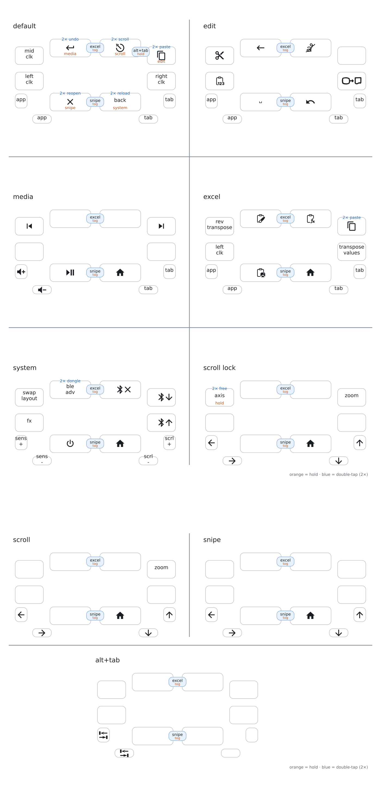

### Firmware for PAW3395

[Download latest UF2](https://nightly.link/phuertay/endgame-trackball-config/workflows/build/paw3395/firmware.zip)

The `firmware.zip` contains two files:
- `efogtech_trackball_0-zmk.uf2` — the normal firmware.
- `efogtech_trackball_0-settings-reset.uf2` — flash this once to wipe the settings/keymap saved on the device (ZMK Studio persists the keymap to on-device storage, which otherwise shadows keymap changes shipped in new firmware), then flash the normal firmware.

### Keymap

The diagram above is generated from the keymap by [keymap-drawer](https://github.com/caksoylar/keymap-drawer) and refreshed automatically by the `Draw keymap` GitHub Action whenever the keymap changes. It uses a compact draw-only layout (shorter side keys, larger type) defined in `keymap-drawer/draw-layout.dtsi` — firmware geometry is unchanged. Labels live in `keymap_drawer.config.yaml`.

Sources: [keymap.svg](keymap-drawer/keymap.svg) (page 1) · [keymap-page2.svg](keymap-drawer/keymap-page2.svg) (page 2) · [keymap.pdf](keymap-drawer/keymap.pdf)

Layers are ordered by approximate complexity: page 1 is default → edit → media → excel → system → scroll lock; page 2 is scroll → snipe → alt+tab. Each GitHub release also includes a two-page US Letter `keymap-layout.pdf` of the same diagram.
